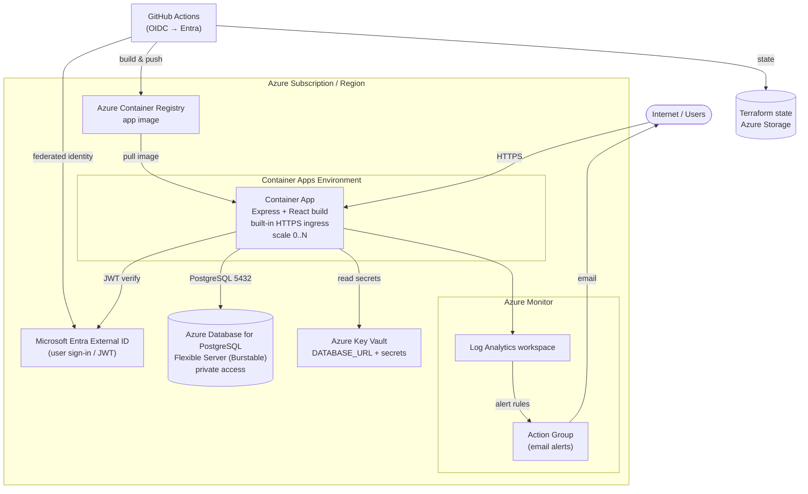
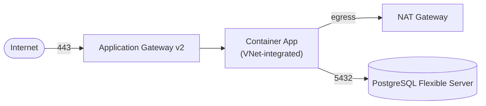

# DeterminEat — Azure Alternative (Exercise)

A thought exercise: what would the AWS infrastructure (see
[`infrastructure.md`](./infrastructure.md)) look like if it were rebuilt on
Microsoft Azure, and what would it cost per month?

> This is a design/costing exercise only. No Terraform or code for Azure exists
> in this repo — the real deployment target is AWS. Nothing here changes the
> actual infrastructure.

## Service Mapping

| Concern | AWS (today) | Azure equivalent |
|---|---|---|
| Container compute | ECS Fargate | **Azure Container Apps** (serverless, scale-to-zero) — or AKS / App Service for Containers |
| Container registry | ECR | **Azure Container Registry (ACR)** |
| Managed PostgreSQL | Aurora Serverless v2 | **Azure Database for PostgreSQL Flexible Server** (Burstable tier) |
| Ingress / load balancing | Application Load Balancer | **Container Apps built-in ingress** (free) — or **Application Gateway v2** for a true ALB equivalent |
| Outbound internet (private) | NAT Gateway | **Azure NAT Gateway** (only if using a locked-down VNet) |
| Networking | VPC + subnets | **Virtual Network (VNet) + subnets** |
| Authentication | Cognito User Pool | **Microsoft Entra External ID** (formerly Azure AD B2C) |
| Secrets | Secrets Manager | **Azure Key Vault** |
| Logs / metrics / alarms | CloudWatch + SNS | **Azure Monitor + Log Analytics + Action Groups** |
| IaC | Terraform (AWS provider) | **Terraform (azurerm provider)** or Bicep |
| CI/CD OIDC | GitHub OIDC → IAM role | **GitHub OIDC → Entra workload identity federation** |
| TLS certificate | ACM | **App Service Managed Cert / Key Vault cert** |

## Where the architecture would differ

The biggest difference is that **Azure Container Apps bundles things that are
separate services on AWS**. Container Apps gives you:

- **Built-in HTTPS ingress** with a free managed certificate and an auto-assigned
  FQDN — so you often don't need a separate load balancer at all.
- **Scale-to-zero** — the app can scale to 0 replicas when idle and cost nothing
  for compute during quiet periods (ECS Fargate always runs the task).
- **Managed egress** — in the default (non-VNet-integrated) setup there's no NAT
  Gateway to pay for.

That leads to two realistic Azure designs:

1. **Minimal (recommended for a personal app).** Container Apps with built-in
   ingress, no Application Gateway, no NAT Gateway, no custom VNet. Dramatically
   cheaper and simpler. The trade-off is less network isolation (the database
   still uses private access, but the app environment is Azure-managed).

2. **Closer 1:1 with the AWS design.** Container Apps in a custom VNet, behind
   Application Gateway v2, with a NAT Gateway for egress and the database on a
   private subnet. This mirrors the AWS network isolation but adds the two
   expensive always-on components back.

## Diagram (minimal design)

For the **closer 1:1 design**, add an Application Gateway v2 in front of the
Container App and a NAT Gateway for the VNet's outbound traffic:

## Cost Estimate

**Assumptions** — same methodology as [`cost-estimate.md`](./cost-estimate.md):
low personal-app traffic, 730 hours/month, pay-as-you-go, no reservations or
free-trial credits. Prices are a representative US region (e.g. East US) **as of
October 2026** and will drift. Verify with the
[Azure Pricing Calculator](https://azure.microsoft.com/pricing/calculator/).

### Minimal design

| Resource | Rate (approx, US region) | Monthly |
|---|---|---|
| Container Apps — compute (0.5 vCPU / 1 GiB, 1 replica) | ~$0.000024/vCPU-s + ~$0.000003/GiB-s (active); idle rate lower | ~$10–20, less with scale-to-zero |
| Container Apps — free grant | first 180k vCPU-s + 360k GiB-s/mo free | −$0 to −$a few |
| PostgreSQL Flexible Server — Burstable **B1ms** (1 vCore, 2 GiB) | ~$0.018/hr compute | ~$13 |
| PostgreSQL storage (32 GiB) | ~$0.115/GiB-mo | ~$4 |
| PostgreSQL backups (within retained size) | included up to DB size | ~$0–1 |
| Azure Container Registry — Basic | ~$0.167/day | ~$5 |
| Key Vault | ~$0.03 / 10k operations | ~$0–1 |
| Log Analytics ingestion | first 5 GB/mo free, then ~$2.76/GB | ~$0–3 |
| Entra External ID | first 50k MAU free | ~$0 |
| **Minimal total** | | **~$35–50 / mo** |

### Closer 1:1 design (adds AWS-style isolation)

Start from the minimal total, then add the always-on network components:

| Added resource | Rate (approx) | Monthly |
|---|---|---|
| Application Gateway v2 — fixed | ~$0.26 / gateway-hr | ~$190 |
| Application Gateway v2 — capacity units | ~$0.008 / CU-hr | ~$6+ |
| NAT Gateway — fixed | ~$0.045 / hr | ~$33 |
| NAT Gateway — data processing | ~$0.045 / GB | ~$1–5 |
| **Added subtotal** | | **~$230+ / mo** |
| **1:1 total** | | **~$265–280 / mo** |

> Application Gateway v2's fixed hourly charge (~$190/mo just to exist) is the
> single biggest reason the 1:1 design is expensive. Azure Front Door
> (consumption) or simply using the Container Apps built-in ingress avoids it.

## Comparison with AWS

| | AWS (today) | Azure minimal | Azure 1:1 |
|---|---|---|---|
| Compute | Fargate ~$17 | Container Apps ~$10–20 (→$0 idle) | same |
| Database | Aurora v2, scale-to-zero ~$0–10 idle | PostgreSQL Burstable ~$17 | same |
| Load balancer | ALB ~$16 | built-in ingress ~$0 | App Gateway ~$196 |
| Egress / NAT | NAT ~$33 | none ~$0 | NAT ~$34 |
| **Rough total** | **~$75–100** | **~$35–50** | **~$265–280** |

> The AWS database now uses **scale-to-zero** (`aurora_min_capacity = 0`, see
> [`cost-estimate.md`](./cost-estimate.md)), so Aurora is no longer a ~$44/mo
> always-on cost — it bills near $0 while idle. That cut the AWS total from
> ~$115–140 down to ~$75–100 and closed most of the gap with Azure-minimal.

**Takeaways:**

- For a **low-traffic personal app, Azure's minimal design is still the cheapest
  (~$35–50 vs AWS ~$75–100)**, because Container Apps' built-in ingress removes
  the ALB (~$16) and NAT Gateway (~$33) that AWS keeps as always-on costs. With
  both databases now effectively scaling down when idle, the database is no
  longer the main differentiator — the load balancer and NAT are.
- If you insist on **matching the AWS network isolation 1:1**, Azure gets
  *more* expensive, because Application Gateway v2 has a high fixed hourly cost
  compared to an AWS ALB.
- The AWS design sits in the middle: more isolated than Azure-minimal, far
  cheaper than Azure-1:1. The "right" Azure port depends on whether strict VNet
  isolation is a hard requirement or a nice-to-have.

## Caveats

- These are coarse estimates for comparison, not quotes. Actual Container Apps
  and Aurora/PostgreSQL costs depend heavily on real traffic and idle behavior.
- Equivalents aren't identical: Aurora Serverless v2 autoscales ACUs and (as now
  configured) scales to zero when idle, whereas a Burstable Flexible Server is a
  fixed instance size — a flat, predictable cost but not elastic the same way,
  and with no cold-start pause.
- Entra External ID vs Cognito differ in free tiers and token models; a real
  port would need to re-validate the auth flow and JWT verification.
- Data transfer, cross-AZ/zone charges, and premium tiers are omitted.

---

*Azure prices sourced from Microsoft Azure pricing pages (Container Apps,
Database for PostgreSQL Flexible Server, Application Gateway, NAT Gateway),
representative US region, October 2026. Figures were recomputed for this
project's configuration; content was rephrased for compliance with licensing
restrictions.*
