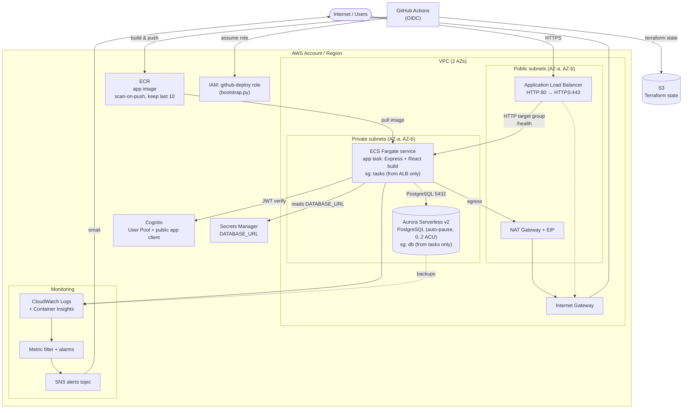
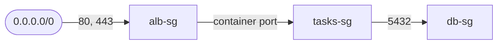

# DeterminEat — AWS Infrastructure

A detailed view of the AWS resources provisioned by the Terraform configuration
under `infra/`. For the higher-level system/component view, see
[`architecture.md`](./architecture.md).

The diagram below is generated from the Terraform modules:

| Module | Resources |
|---|---|
| `vpc` | VPC, 2 public + 2 private subnets across 2 AZs, Internet Gateway, single NAT Gateway + EIP, route tables |
| `alb` | Public Application Load Balancer, target group (`/health`), HTTP→HTTPS redirect + HTTPS listener (or HTTP-only without a cert), ALB security group |
| `ecs` | ECS cluster (Container Insights), Fargate task definition + service, CloudWatch log group, task + execution IAM roles |
| `aurora` | Aurora Serverless v2 (PostgreSQL) cluster + instance, DB subnet group, DB security group, Secrets Manager secret (`DATABASE_URL`) |
| `cognito` | Cognito User Pool + public app client |
| `ecr` | ECR repository (scan-on-push, keep last 10 images) |
| `monitoring` | SNS alerts topic (+ email sub), log metric filter, CloudWatch alarms |
| `github_oidc` | Data-source reference to the deploy IAM role (created by `bootstrap.py`) |
| root | ECS tasks security group (breaks the ecs↔aurora cycle) |

## Infrastructure Diagram

## Security Groups & Traffic Flow

The security groups enforce a strict one-way ingress chain:

- **`alb-sg`** — accepts HTTP (80) and HTTPS (443) from anywhere; egress open.
- **`tasks-sg`** — ingress only from `alb-sg` on the container port; egress open
  (outbound internet via the NAT Gateway). Defined at the Terraform root to
  break the circular dependency between the `ecs` and `aurora` modules.
- **`db-sg`** — ingress only from `tasks-sg` on 5432 (PostgreSQL); egress open.

## Networking Notes

- Two availability zones; each gets one public and one private subnet.
- Public subnets host the ALB and a **single** NAT Gateway (one NAT keeps cost
  down for a personal app — for HA you would run one per AZ).
- Private subnets host the ECS tasks and Aurora. Tasks reach the internet
  outbound through the NAT Gateway; neither tasks nor the database are directly
  reachable from the internet.
- The ECS task reads `DATABASE_URL` from Secrets Manager at start; Cognito IDs
  are passed as plain environment variables (they are not secrets).
